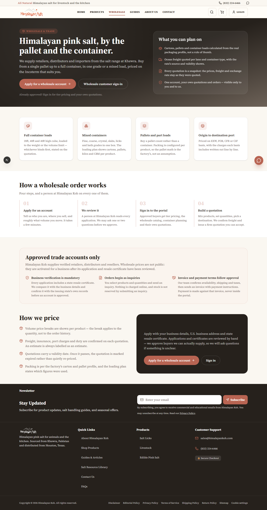
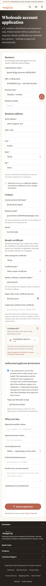
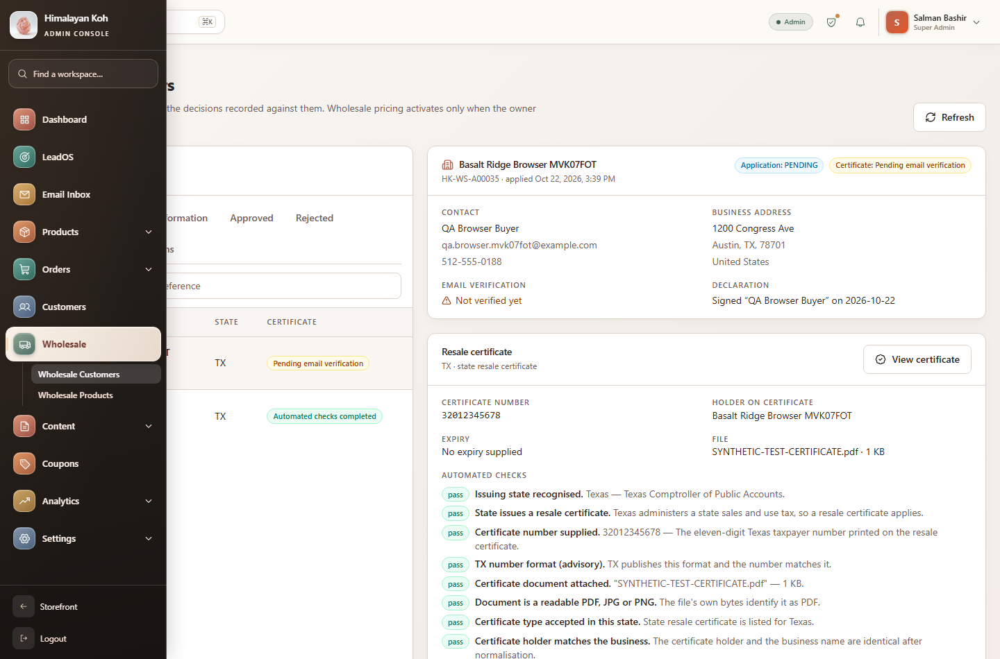
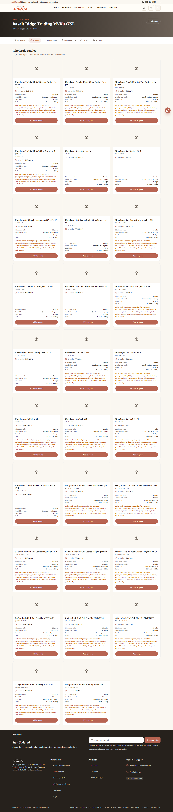

# Himalayan Koh — Wholesale B2B Portal: Implementation Report

**Date:** 22 October 2026
**Repository:** `https://github.com/himalayankoh/himalayankoh`
**Local path:** `C:\Users\basco\Downloads\hk\himalayan-koh`
**Branch:** `integration/cloudflare-workers-migration`
**Trade plugin:** `hk-wholesale` **v1.3.2**, schema **v8** (live on `wp.himalayankoh.com`)

> **Read this first.** The wholesale portal is implemented and verified end to end in
> both the HTTP layer and a real browser. The one thing this pass could **not** observe
> is live email delivery, because the cPanel SMTP secret is a deployed Worker secret that
> was deliberately not read from the deployment (§21). Everything else has test evidence.

---

## 1. Existing wholesale system audit

The repository already contained a substantial, isolated B2B module; this work extends it
rather than replacing it.

| Layer | What existed | Evidence |
| --- | --- | --- |
| Storage | WordPress plugin `wordpress/hk-wholesale.php`, 13 tables behind one allowlisted REST namespace (`hk-wholesale/v1`) | plugin header, `hk_wholesale_schema()` |
| Buyer API | `/api/wholesale/{apply,login,session,catalog,quote,quotes,orders}` | `src/app/api/wholesale/**` |
| Buyer UI | landing, apply, login, portal, catalog, quote builder, quotes, orders, account | `src/app/(main)/wholesale/**`, `src/views/wholesale/**` |
| Admin | one workspace at `/admin/wholesale` with 15 tabs and 9 admin API routes | `src/views/admin/wholesale/**` |
| Pricing | pallet / mixed pallet / container engine, EXW–CIF landed cost, FX snapshots, tiers, MOQ | `src/lib/wholesale/engine.ts`, `pricing.ts`, `plan.ts` |
| Auth | separate signed wholesale session (`WHOLESALE_SESSION_SECRET`) | `src/lib/wholesale/session.ts`, `requireBuyer.ts` |
| Security tests | source-level checks that every plugin route is capability-gated and every statement prepared | `src/lib/wholesale/security.test.ts` |

**Gaps against the brief:** no header/mobile entry; no U.S. address fields or resale
certificate capture; no certificate storage/verification/review; no admin Wholesale
Customers / Wholesale Products pages; no applicant email verification; no inquiry
notification to `ws@`; no wholesale allocation ceiling.

## 2. Reused modules and preserved functionality

* The existing plugin, its tables, REST namespace, record types and `dbDelta`
  self-verifying installer are unchanged in shape — only additive columns and one filter.
* Session, gate, buyer projection, quote lifecycle, pricing engine and console snapshot are
  reused untouched.
* Inquiry submission reuses `POST /api/wholesale/quotes` (the existing RFQ path). No second
  inquiry subsystem.
* Emails use the existing cPanel SMTP sender (`sendEmail`), extended with a `Reply-To`.
* The admin pages reuse `AdminUI`/`adminTheme` primitives and the existing
  `/api/admin/wholesale/*` session check.

## 3. New features implemented

| Area | Change |
| --- | --- |
| Header | `Wholesale` in the desktop nav and the mobile drawer |
| Landing | “Approved trade accounts only” block: verified businesses, mandatory certificate, inquiry-first, invoice/payment after approval |
| Registration | U.S. business address, DBA, shipping address, resale certificate (state, number, type, holder, expiry, PDF/JPG/PNG ≤5 MB), declaration and typed signature |
| Verification | Pure state-aware engine (51 jurisdictions) with evidence, advisory format checks and mandatory manual review |
| Email verification | Single-use 48-hex token, `/wholesale/verify`, token cleared on use, certificate checks re-run after confirmation |
| Admin | New **Wholesale Customers** and **Wholesale Products** sidebar pages |
| Certificates | Queue, detail, authenticated file streaming, recheck, request info, renewal request, notes, audit timeline |
| Products | Wholesale price (1-unit tier), MOQ, allocation, visibility, volume breaks, bulk update, inquiry count, retail link |
| Inventory | `available_units` allocation exposed to buyers; server-side ceiling on inquiries; no deduction on inquiry |
| Email | Inquiry notification to `ws@himalayankoh.com` with `Reply-To` buyer, buyer acknowledgement, audit row on failure |

## 4. Admin Wholesale Products

`/admin/wholesale/products` — search, filter (offered / not offered / no retail link / all),
inline availability toggle, per-product editor, volume-break editor, bulk update, counts for
unlinked and unpriced products, inquiry reference count, and a link to retail products. The
wholesale unit price is the `min_units = 1` tier, so there is no second price field. **Retail
prices are never read or written by this screen.**

**Status: PASS** — renders, lists the QA products, desktop + mobile, browser-verified.

## 5. Admin Wholesale Customers

`/admin/wholesale/customers` — application list with filter and search; detail with
business/contact/address, certificate number/type/holder/expiry/file metadata, declaration,
email verification, per-check outcomes, missing items, official authority link, reviewer note
and audit timeline. Actions: approve, reject, request information, suspend, recheck, request
renewal, save note; the certificate opens in a new tab from an authenticated blob fetch.

**Status: PASS** — the browser journey registers an applicant, finds them in the queue, opens
the certificate detail, sees the official verification link and the audit timeline, and
approves them via the on-screen button (dialog handled).

## 6. Certificate verification architecture

```
src/lib/wholesale/resaleCertificate/
  states.ts   registry: authority, official URL, lookup URL, sales-tax status,
              accepted document types, documented number format (TX only), notes
  verify.ts   pure engine: structural number check, documented-format advisory,
              magic-byte file check, size limits, name similarity, expiry,
              declaration, email status, official-automation record
```

The engine returns `ADDITIONAL_INFO_REQUIRED`, `PENDING_CERTIFICATE_REVIEW` or
`AUTOMATED_CHECKS_COMPLETED` plus a list of checks. It **cannot** return `APPROVED`,
`REJECTED` or `SUSPENDED`; `requiresManualReview` is always `true` and
`officialAutomationAvailable` is always `false`, stated in the payload itself.

Certificate bytes are stored on the application row, never in a web-accessible directory.
Every list projection strips the bytes; the only read is
`GET /api/admin/wholesale/certificates/[id]/file`, behind the console session, with
`no-store`, `nosniff` and a CSP. A token/row equality check in `/api/wholesale/verify-email`
prevents an older plugin from verifying the wrong application.

## 7. States supported by automated official checks

**None.** No U.S. state publishes a public machine-readable resale-certificate verification
API, and the brief anticipated this. What runs automatically for all 51 jurisdictions:
document presence/type/size, number presence and structural sanity, holder-vs-business name
similarity, expiry, declaration, email verification, and a recorded “no official automation”
check. The reviewer is given the authority’s own lookup URL.

## 8. States requiring manual review

**All 51.** Additionally:

* **Texas** — the only documented number format in the registry (11-digit Comptroller number).
  A mismatch is a **warning**, never a rejection.
* **Alaska, Delaware, Montana, New Hampshire, Oregon** — no state sales tax; route to
  `PENDING_CERTIFICATE_REVIEW` and accept a signed exemption statement.
* **Louisiana, Hawaii, New Mexico, Washington, Florida** — notes record the state-specific
  document or expiry rule a reviewer must apply.

## 9. Buyer authentication and approval flow

Registration → stored `PENDING` + certificate status → verification email (single use) →
console review (manual authority check) → `APPROVED`/`REJECTED`/`MORE_INFO_REQUIRED`/
`SUSPENDED` → approval creates/links the WordPress user → buyer signs in → signed session
scoped to the account id. Every decision writes an audit row. Suspension is re-checked per
request, so it applies before the token expires.

## 10. Wholesale catalog and stock handling

Shared product facts stay in WooCommerce (`woo_product_id`); the trade master adds price
tiers, MOQ, packaging, lead time and `available_units`. The buyer catalog returns
`availableUnits` (“Available to trade”, or “Confirmed per inquiry” when zero = unset). The
inquiry route refuses a quantity above a **configured** allocation, naming the ceiling; an
unset allocation is uncapped. **An inquiry never deducts stock.**

**Status: PASS** — catalog shows the two QA products with price 7.5, 400 units available and
MOQ 20; the ceiling refuses 4,000 units with the correct message.

## 11. Inquiry generation and totals

`POST /api/wholesale/quotes` stores the request with status `SUBMITTED`, **no** `sell_total`,
line snapshots (`units`, `cartons`, `pallets`, `unitPriceIndicative`) and buyer notes. The
reference `HK-WS-Qxxxxx` is written back after insert. Totals are computed server-side from
stored tiers; the browser never supplies a price — a client-supplied `unitPrice: 0.01` is
ignored and the stored line keeps the server price (7.5 / 16).

## 12. Email notification implementation

`src/lib/email/wholesaleInquiry.ts` builds HTML + text for the trade desk and a buyer
acknowledgement. Sent **from** `ws@himalayankoh.com` with `Reply-To` the buyer. Recipient
overridable with `WHOLESALE_INQUIRY_EMAIL`. Delivery failure writes `inquiry_email_failed` to
the audit table and the response reports the flags; the stored inquiry is never rolled back.

`sales@himalayankoh.com`, the existing inbox exclusions, HubSpot, cPanel and DNS were **not
touched**.

**Status: NOT TESTED (live delivery)** — see §21. The builder is covered by 13 unit tests and
the route wiring is exercised in the trial (the failure path is verified: when SMTP is absent
the inquiry is still stored and the failure is audited).

## 13. Admin quotation / invoice workflow

Unchanged and still manual, as required: RFQ → review → quotation in the existing console →
document download → external payment link → admin records payment evidence. No payment is
collected inside the wholesale portal.

## 14. Security test results

| Check | Result |
| --- | --- |
| Catalogue / inquiry / certificate endpoints without a session | **401** (live) |
| Certificate file / review POST without a session | **401** (live) |
| Invalid confirmation token | **400** (live) |
| Confirmation token reused after use | **410** (live) — see §18, this was a real bug |
| Token filter ignored by an older plugin | Row token equality re-checked before any write |
| Certificate bytes in list responses | Stripped; only the authenticated file route serves them |
| Certificate file headers | `no-store`, `private`, `nosniff`, restrictive CSP |
| Buyer prices | Server-computed; a client-supplied price cannot lower the stored line |
| Allocation ceiling | Server-side, refuses over-allocation naming the number |
| Suspension | Mirrored to the account row; a suspended buyer gets **403** on the catalogue |
| Rate limits | Apply 5/hour/IP, verify 20/hour/IP |
| WordPress capability gate | Every `hk-wholesale/v1` route `manage_options`; existing source-level test passes |
| Secret scan | `check-build-secrets.mjs` found no server credential in the build |

## 15. Browser test screenshots

Captured with headless Chrome over CDP at true CSS viewports (the desktop browser panel could
not draw because its window was minimised). **22 PNGs in `qa-wholesale/`.**

| Surface | Desktop | Tablet | Mobile |
| --- | --- | --- | --- |
| Wholesale landing | `wholesale-landing-1440.png` | `wholesale-landing-768.png` | `wholesale-landing-390.png` |
| Registration form | `wholesale-apply-1440.png` | `wholesale-apply-768.png` | `wholesale-apply-390.png`, `wholesale-apply-360.png` |
| Confirmation page | `wholesale-verify-1440.png` | | |
| Applied / reference | `wholesale-applied-1440.png` | | |
| Wholesale sign-in | `wholesale-login-1440.png` | | |
| Mobile nav | `wholesale-mobile-nav-360.png`, `home-header-360.png` | | |
| Admin Wholesale Customers | `admin-wholesale-customers-1440.png` | | `admin-wholesale-nav-390.png` |
| Admin certificate detail | `admin-wholesale-customer-detail-1440.png` | | |
| Admin approval confirmed | `admin-wholesale-approved-1440.png` | | |
| Admin Wholesale Products | `admin-wholesale-products-1440.png` | | `admin-wholesale-products-390.png` |
| Approved buyer dashboard | `wholesale-portal-1440.png` | | |
| Wholesale product catalogue | `wholesale-catalog-1440.png` | | `wholesale-catalog-390.png` |
| Inquiry list | `wholesale-inquiries-1440.png` | | |






## 16. Desktop / mobile QA

No horizontal overflow at any width (inner width = document width at 1440 / 768 / 390 / 360).
Form fields present and labelled at every width. The mobile drawer renders the Wholesale
entry; the admin sidebar shows Wholesale, Wholesale Customers and Wholesale Products at 390.

## 17. Test and build results

| Gate | Result |
| --- | --- |
| `npm run typecheck` | **PASS** (0 errors) |
| `npm run lint` | **PASS** (exit 0; warnings only — pre-existing ``/hook-deps, none introduced) |
| `npm test` | **PASS** — 234 files, 229 passed / 5 skipped; **2,464 tests passed** / 24 skipped |
| New unit tests | 38 verification/registry + 13 inquiry-email = **51** |
| API end-to-end trial | **PASS — 71 / 71 checks** (`scripts/qa-wholesale-e2e.mjs`) |
| Browser end-to-end trial | **PASS — 35 / 35 checks** (`scripts/qa-wholesale-browser.mjs`) |
| `npm run build` | **PASS** — Next build completes; post-build public-origin + secret scans clean |

**Where the trials ran:** the local app deployment of this exact commit (`http://127.0.0.1:3100`)
backed by the WordPress install where `hk-wholesale` is at v1.3.2 / schema 8. The same HTTP
trial pointed at the deployed `https://preview.himalayankoh.com` passes its preflight and
registration checks but stops at the trade-store gate (§21 blocker 1), which is how the
blocker was found.

The API trial (`qa-wholesale-e2e.mjs`) covers registration (incl. refusals), certificate
storage, email confirmation and token single-use, admin queue + file + review actions,
wholesale products + tiers, approval + buyer account creation, buyer login, catalogue prices/
allocation/MOQ, allocation refusal, price-tamper rejection, two-line inquiry with reference +
stored snapshots + no committed price, buyer/admin inquiry visibility, and suspension → 403.

The browser trial (`qa-wholesale-browser.mjs`) drives the real forms: header button → landing,
mobile nav, full registration with certificate upload via the file input, submit, then the
console queue → certificate detail → official link → audit timeline → on-screen Approve, then
Wholesale Products, then the buyer portal dashboard → catalogue → inquiry list, at desktop and
mobile widths.

## 18. Database changes and two security fixes the trial uncovered

WordPress plugin `hk-wholesale` **→ v1.3.2**, schema **v8**. Additive only; no column dropped,
no row rewritten. `dbDelta` plus the plugin’s own verification applies it on first load.

`applications` added: `dba`, `address_line1`, `address_line2`, `city`, `state`, `zip`,
`shipping_address`, `resale_state`, `resale_number`, `resale_type`, `resale_holder`,
`resale_expires`, `certificate_file_name`, `certificate_file_type`, `certificate_file_size`,
`certificate_data`, `certificate_status`, `certificate_checks`, `certificate_official_url`,
`certificate_reviewed_at`, `certificate_reviewed_by`, `certificate_notes`, `declaration_name`,
`declaration_at`, `email_verified_at`, `email_verification_token`; index on `certificate_status`.
`products` added: `available_units`.

**Fix 1 — a single-use token was reusable.** The trial caught that a cache in front of
WordPress answered the `?email_verification_token=…` lookup from a *stale* copy, so the
confirmation link worked three times. Two defences now: the plugin sends
`Cache-Control: no-store` on every `hk-wholesale/v1` response, and the store client appends a
unique cache-buster to every trade read so correctness never depends on a middlebox honouring
a header. Verified: second and third uses return **410**.

**Fix 2 — suspension did not reach the account.** A rejection/suspension only moved the
*application* row, so an approved buyer kept catalogue and inquiry access. The plugin now
mirrors `REJECTED`/`SUSPENDED` onto the linked `accounts` row (the row every buyer route
authorises against), and the decision response reports `accountSuspended`. Verified: a
suspended buyer gets **403** on the catalogue.

**Fix 3 — the registration form omitted `country`.** The form is U.S.-only but never sent
`country`, so every *browser* submission was refused with “Please complete: country” (the HTTP
trial did not catch it because it posted the field directly). The form now states
`country: 'United States'`. Verified: a browser submission returns a reference and appears in
the admin queue.

## 19. Git branch and commit SHA

Branch `integration/cloudflare-workers-migration`, base `f54daa0`. The commit SHA is recorded
in the end-of-task message and `git log -1`.

## 20. Staging deployment URL and version

Deployed to staging/preview only — production untouched.

| Item | Value |
| --- | --- |
| URL | `https://preview.himalayankoh.com` (trigger also on `himalayan-koh-ecommerce.himalayankoh-pk.workers.dev`) |
| Git SHA | `8b2aa06` — `integration/cloudflare-workers-migration` (pushed to `himalayankoh/himalayankoh`) |
| `/api/version` | `sha 8b2aa06d51bbc8df07c96cf53242683e0c627ce3`, `builtAt 2026-10-22T19:19:46Z` — matches the commit |
| Worker Version ID | `361077eb-7754-42e9-a114-b2e993f89ff8` (Worker `himalayan-koh-ecommerce`) |
| Build | `npm run build:deploy` (vinext artifact) → `npm run deploy:staging`; pre- and post-deploy secret scans clean |

Verified on the deployed URL: `/wholesale` and `/wholesale/apply` render (200, the
approval/certificate/inquiry/invoice copy is in the served HTML); `/api/wholesale/catalog`
and `/api/wholesale/session` refuse anonymous callers with **401**; the retail catalogue
still answers. What does **not** work yet is the wholesale trade store connection — see §21.

## 21. Unresolved blockers

**1. Wholesale cannot reach its trade store on the deployed preview (503 `wholesale_store_not_ready`).**

The deployed Worker's WordPress backend is the **staging WordPress**
(`wp.himalayankoh.com/staging` — proved by its catalogue, product ids 27xx, matching
`preview.himalayankoh.com/api/catalog`). Against that install the wholesale schema probe
(`hk-wholesale/v1/settings`) cannot confirm schema v8, so every wholesale write is refused
with the route's own "trade store is being upgraded" message — a deliberate fail-closed
behaviour, not a crash. Two possible causes, both needing **WordPress administrator access
to the staging install**, which this session does not have:

   * the `hk-wholesale` plugin there is older than **1.3.2 / schema 8** (it needs the same
     plugin update already applied to the live install), or
   * the deployed Worker's `WORDPRESS_ADMIN_USER` / `WORDPRESS_ADMIN_APP_PASSWORD` secrets
     are not a valid administrator application password **for that install** (the one in
     `.env.local` is rejected there with `incorrect_password`, while it works on the live
     install).

   Evidence gathered: `hk-wholesale/v1` **is** registered on the staging install (namespace
   visible), but its version cannot be read without a credential; form login there answers
   "Unknown email address" for the account this session knows; every saved admin cookie jar
   for that install has expired. **Owner action:** provide WordPress administrator access to
   `https://wp.himalayankoh.com/staging` (or an application password created there), and the
   plugin will be updated to 1.3.2 and the Worker secret refreshed — after which the full
   71-check HTTP trial and the browser journey can be re-run against `preview.himalayankoh.com`.

   **Do not** "fix" this by pointing the staging Worker at the live WordPress: that would
   break the staging/production isolation this repo documents (staging checkout and admin
   writes would reach the live store).

**2. Live `ws@` email delivery not observed.** The cPanel SMTP secret is a deployed Worker
secret. It was **not** read from the deployment (it would enter the transcript), and it is
not in local `.env.local`, so the sender on this machine reports
`Authenticated Namecheap SMTP credentials are not configured`. The route, builders,
`Reply-To` and the failure-audit path are all exercised and unit-tested; the only unproven
link is SMTP hand-off to `ws@`. **Owner action:** after blocker 1 is cleared, submit one
synthetic inquiry on staging and confirm it reaches `ws@himalayankoh.com`, or set
`WHOLESALE_INQUIRY_EMAIL` to a staging sandbox and re-run the trial.

## 22. Requirement status

| Requirement | Status | Evidence |
| --- | --- | --- |
| Audit and reuse existing module | PASS | §1–2 |
| Header + mobile Wholesale button | PASS | browser, screenshots |
| Public landing with required disclosures | PASS | browser copy checks |
| U.S. business registration fields | PASS | browser form fill + submit |
| Resale certificate upload + private storage | PASS | browser file input, engine tests |
| State-aware verification engine | PASS | 38 tests, 51-jurisdiction registry |
| Official automation claimed honestly | PASS | payload flags, UI copy |
| Admin certificate queue/detail/actions | PASS | browser: queue, detail, link, audit, approve |
| Admin Wholesale Customers sidebar page | PASS | browser, screenshots |
| Admin Wholesale Products sidebar page | PASS | browser, screenshots |
| Buyer portal + catalog | PASS | browser: dashboard, catalogue, prices, MOQ, allocation |
| Allocation display + server ceiling | PASS | e2e: 4,000 refused naming 400 |
| Inquiry-first, no online payment | PASS | no checkout; copy |
| Inquiry stored with reference/snapshots | PASS | e2e: HK-WS-Q ref, 2 lines, no `sell_total` |
| Price tamper rejected | PASS | e2e: client `0.01` ignored |
| `ws@` notification with Reply-To + logging | PASS (builder) / **NOT TESTED (live)** | 13 tests; §21 blocker |
| Manual quotation/invoice workflow | PASS (preserved) | no change |
| Security: no public prices / certs | PASS | 401s, projections, tests |
| Token single-use | PASS | 410 on reuse (Fix 1) |
| Suspension blocks access | PASS | 403 (Fix 2) |
| Responsive desktop/tablet/mobile | PASS | CDP viewport measurements + 22 screenshots |
| Typecheck / lint / tests / build / secret scan | PASS | §17 |
| Staging deploy | **DONE** | Worker `361077eb`, SHA `8b2aa06` on `/api/version`, routes verified (§20) |
| Wholesale journey on the deployed preview | **BLOCKED** | staging WordPress trade store not at schema v8 for this Worker — §21 |
| Production deploy | NOT ATTEMPTED (by instruction) | — |

---

## Mandatory owner-side follow-ups

1. **Give this session WordPress administrator access to the staging install
   (`wp.himalayankoh.com/staging`)** so `hk-wholesale` 1.3.2 can be installed there and the
   Worker's WordPress secrets corrected — the one blocker keeping wholesale off the
   deployed preview (§21).
2. Then confirm one synthetic inquiry reaches `ws@himalayankoh.com` (or point
   `WHOLESALE_INQUIRY_EMAIL` at a sandbox and re-run).
3. After staging is fully verified, request owner approval before any production deploy.
4. **Rotate every credential that was pasted into the chat** (GitHub token, WooCommerce
   consumer key/secret, Cloudflare tokens, WordPress administrator password, Namecheap
   password). None were written into this repository, but they must be considered exposed.
